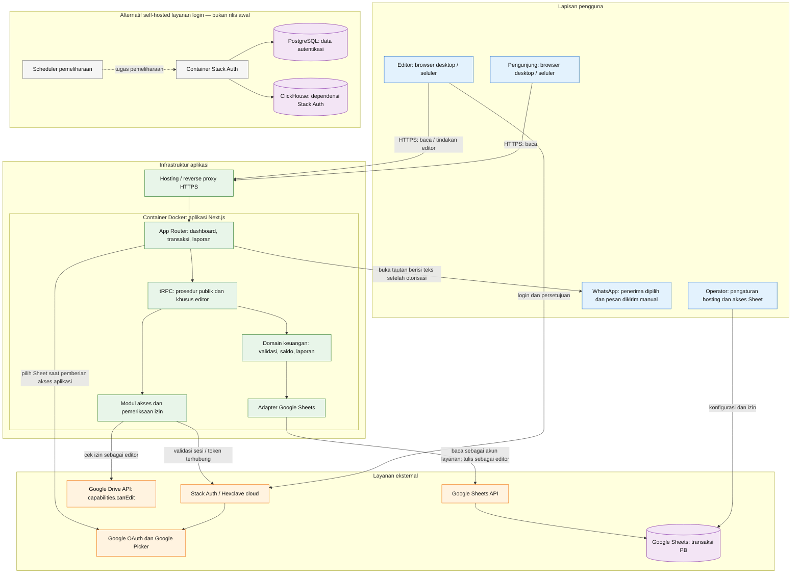

# Arsitektur Epic: Pencatatan Keuangan PB

Status: rancangan tingkat tinggi; belum diimplementasikan. Acuan kebutuhan: [Epic PRD](./epic.md).

## 1. Ikhtisar Arsitektur

Aplikasi menggunakan Next.js App Router sebagai antarmuka dan backend dalam satu aplikasi. Modul domain keuangan mengelola transaksi, saldo, dan laporan; adapter Google Sheets menangani penyimpanan. Google Sheets tetap menjadi sumber data transaksi, bukan salinan di database aplikasi.

Pengunjung membaca data publik tanpa login. Editor masuk dengan Google melalui Stack Auth cloud, yang saat ini didokumentasikan sebagai Hexclave. Untuk setiap tindakan khusus editor, backend memeriksa kemampuan akun tersebut pada spreadsheet yang ditentukan. Penulisan dilakukan dengan otorisasi Google milik editor, sehingga Google juga menerapkan izin pada saat penulisan.

Layanan login cloud dipilih untuk tahap awal. Aplikasi dapat dijalankan dalam container Docker pada hosting yang mendukungnya. Alternatif menjalankan layanan login sendiri dijelaskan sebagai opsi masa depan, bukan komponen rilis awal.

### Batas domain

- **Keuangan:** validasi transaksi, perhitungan total dan saldo, serta ringkasan berdasarkan periode.
- **Akses:** sesi pengguna, koneksi akun Google, dan pemeriksaan kemampuan editor.
- **Integrasi:** komunikasi dengan Google Sheets dan Drive, serta penyusunan teks berbagi WhatsApp.
- **Presentasi:** dashboard, daftar transaksi, formulir, dan laporan.

Modul dapat berada dalam satu proyek; tidak perlu membuat layanan terpisah untuk masing-masing domain.

## 2. Diagram Arsitektur Sistem

Garis penuh menunjukkan permintaan atau aliran data sinkron. Garis putus-putus menunjukkan alur pemeliharaan asinkron yang hanya diperlukan pada opsi self-hosted layanan login.

Tidak ada aplikasi seluler native, load balancer khusus, worker transaksi, n8n, Redis, atau Qdrant pada rilis awal. Hosting dapat menyediakan reverse proxy atau load balancer jika diperlukan. Diagram self-hosted adalah alternatif untuk layanan cloud, bukan dependensi tambahan pada rilis awal.

## 3. Fitur dan Enabler Teknis

### 3.1 Fitur utama

1. **Dashboard publik:** membaca transaksi dan menghitung total pemasukan, total pengeluaran, serta saldo.
2. **Daftar transaksi publik:** menampilkan tanggal, jenis, jumlah, dan keterangan.
3. **Pencatatan transaksi:** editor membuat pemasukan atau pengeluaran melalui formulir yang tervalidasi.
4. **Laporan periode:** menghitung pemasukan dan pengeluaran berdasarkan periode; saldo yang ditampilkan tetap saldo terkini dari seluruh transaksi.
5. **Berbagi WhatsApp:** setelah pemeriksaan editor, backend menghasilkan teks ringkasan; browser membuka WhatsApp untuk pengiriman manual.

### 3.2 Identitas dan otorisasi

- Stack Auth mengelola sesi login Google; identitas saja tidak membuktikan hak editor.
- Gunakan OAuth client Google milik aplikasi. Menurut dokumentasi connected accounts, kredensial OAuth bersama bawaan Stack Auth tidak mendukung koneksi akun untuk akses API pihak ketiga.
- Hubungkan akun Google yang sama dengan akun login ke aplikasi dan minta scope minimum yang sesuai. Kandidat awal adalah `https://www.googleapis.com/auth/drive.file`; pengguna perlu memberikan akses aplikasi ke spreadsheet yang ditentukan, misalnya melalui Google Picker. Validasi alur ini dalam spike sebelum implementasi: akses editor ke file saja tidak otomatis memberi aplikasi akses melalui scope `drive.file`.
- Pada setiap permintaan pembuatan transaksi atau pembuatan teks berbagi, backend memvalidasi sesi, memperoleh token Google akun yang terhubung, dan memanggil Drive `files.get` untuk spreadsheet yang dikonfigurasi dengan `fields=capabilities(canEdit)` dan dukungan shared drive bila diperlukan.
- Izinkan tindakan hanya jika `canEdit` bernilai `true`. Jangan menyimpan keputusan izin sebagai sumber otorisasi: izin yang dicabut harus diperiksa ulang pada permintaan berikutnya. Penolakan consent, token tidak valid, akses file tidak tersedia, atau kegagalan Drive menghasilkan penolakan yang jelas.
- Tulis transaksi menggunakan token editor yang sama, bukan akun layanan berizin tulis. Ini memungkinkan Google menolak penulisan jika izin berubah setelah pemeriksaan Drive. Perubahan izin antara pemeriksaan dan pembuatan teks berbagi tidak dapat dihilangkan sepenuhnya; pemeriksaan dilakukan tepat sebelum teks dibuat.
- Token dan secret tidak dicatat dalam log. SDK dapat membutuhkan token berumur pendek di browser untuk Picker; batasi pada kebutuhan Picker, jangan simpan permanen di browser, dan tetap lakukan otorisasi di backend.
- Google OAuth consent dan persyaratan verifikasi bergantung pada scope dan konfigurasi aplikasi. Jika `drive.file` tidak mencukupi, evaluasi konsekuensi scope yang lebih luas sebelum memilihnya; beberapa scope Drive berstatus restricted dan dapat memerlukan verifikasi serta penilaian keamanan.
- Pembatasan berbagi berlaku pada fitur aplikasi. Karena laporan publik, pengunjung tetap dapat menyalin informasi dan membagikannya sendiri.

### 3.3 Penyimpanan dan perhitungan

- Satu spreadsheet dikonfigurasi per deployment. Akun layanan khusus hanya diberi izin baca pada spreadsheet tersebut untuk mendukung akses publik; spreadsheet itu sendiri tidak perlu dibuka untuk publik.
- Usulan satu tab transaksi dengan kolom: ID transaksi, tanggal transaksi, jenis, jumlah, dan keterangan. Struktur final, data lama, mata uang, format nilai, dan zona waktu harus disepakati sebelum migrasi atau implementasi.
- Gunakan ID unik untuk mengenali transaksi, validasi skema dan nilai saat membaca, serta format penyimpanan jumlah yang menghindari kesalahan pembulatan. Aturan presisi dan mata uang masih menunggu keputusan produk.
- Gunakan satu implementasi domain untuk total dashboard dan laporan. Saldo adalah seluruh pemasukan dikurangi seluruh pengeluaran, dengan saldo awal nol. Periode laporan bersifat inklusif berdasarkan tanggal transaksi; jika tidak ada transaksi, total periode nol.
- Aplikasi membaca ulang Google Sheets saat memuat data dan setelah penulisan berhasil. Jangan menggunakan cache persisten yang membuat perubahan langsung di Sheets tampak sebagai data terkini. Jika pembacaan atau validasi gagal, tampilkan kesalahan, bukan saldo nol atau data lama yang diklaim terkini.
- Tulisan memakai `values.append` pada rentang tabel transaksi dengan input mentah agar keterangan tidak dievaluasi sebagai formula. Konfigurasi tab harus mencegah baris atau kolom lain mengganggu deteksi tabel.
- Timeout saat append memiliki hasil yang tidak pasti: baris mungkin sudah tersimpan meskipun respons gagal. Jangan otomatis mengirim append ulang. Pertahankan ID permintaan, periksa keberadaan ID setelah koneksi pulih, dan beri tahu editor jika hasil belum dapat dipastikan. Perlu prosedur rekonsiliasi sebelum mencoba lagi.
- Google Sheets tidak menyediakan jaminan keunikan ID atau transaksi idempoten untuk append. Pemeriksaan ID saja tidak menjamin bebas duplikasi pada permintaan bersamaan; uji kasus ini dan tetapkan mekanisme koordinasi persisten bila jaminan exactly-once diperlukan. Sampai itu tersedia, jangan mengklaim exactly-once.

### 3.4 Kontrak aplikasi

- Prosedur publik menyediakan daftar transaksi dan ringkasan dashboard/laporan. Input periode divalidasi di server.
- Prosedur khusus editor membuat transaksi dan menghasilkan teks berbagi. Keduanya wajib melewati pemeriksaan akses yang sama di server.
- Respons membedakan input tidak valid, sesi tidak tersedia, akses ditolak, kegagalan layanan eksternal, dan hasil penyimpanan yang belum pasti.
- Formulir mencegah pengiriman ganda selama permintaan berlangsung, tetapi perlindungan UI bukan pengganti penanganan duplikasi di server.
- Terapkan HTTPS, perlindungan CSRF/origin sesuai mekanisme sesi, validasi input, dan pembatasan permintaan publik sesuai kemampuan hosting. Jangan mengekspos kredensial akun layanan atau secret aplikasi.

### 3.5 Deployment dan operasi

- **Awal:** satu image Docker aplikasi Next.js, hosting HTTPS, Stack Auth cloud, Google OAuth, Google Drive API, Google Sheets API, dan akun layanan pembaca. Konfigurasi dan secret disediakan oleh lingkungan deployment, bukan disimpan dalam repositori.
- **Self-host aplikasi:** operator mengelola container, domain, TLS, log, pembaruan, dan backup konfigurasi. Login dan spreadsheet tetap memakai layanan cloud eksternal; ini bukan sistem yang sepenuhnya offline atau self-contained.
- **Alternatif self-host login:** dokumentasi vendor menyebut container server Stack Auth, PostgreSQL, ClickHouse, reverse proxy, dan scheduler sebagai dependensi produksi. Opsi ini menambah biaya operasi dan tanggung jawab pembaruan; evaluasi lisensi dan kebutuhan penyimpanan sebelum adopsi.
- Tidak ada database transaksi, queue, Redis, Qdrant, atau n8n pada rilis awal. Tambahkan hanya jika kebutuhan terukur atau jaminan konsistensi baru membenarkannya. Turborepo belum diperlukan untuk satu aplikasi; pertimbangkan bila ada beberapa aplikasi atau paket bersama.
- Catat keberhasilan dan kegagalan operasi, pemeriksaan akses, latensi, serta kondisi hasil append tidak pasti tanpa mencatat token atau isi transaksi. Pantau kuota dan error Google API.
- Operator perlu rencana backup dan pemulihan Google Sheets serta konfigurasi, dan perlu menguji pemulihan sebelum produksi. Target ketersediaan dan pemulihan masih menunggu keputusan.

### 3.6 Verifikasi dan risiko

- Uji pengunjung anonim, editor, pengguna bukan editor, izin yang dicabut, consent ditolak, token kedaluwarsa, dan kegagalan Drive; tindakan editor harus gagal tertutup.
- Uji pemasukan, pengeluaran, saldo negatif, periode tanpa transaksi, tanggal batas, perubahan langsung di Sheets, data tidak valid, serta kesesuaian dashboard, laporan, dan teks WhatsApp.
- Uji timeout append sebelum dan setelah Google memproses permintaan, pengiriman ganda, dan append bersamaan. Dokumentasikan batas jaminan duplikasi.
- Uji akses baca publik ketika spreadsheet tetap privat, serta pastikan akun layanan tidak memiliki izin tulis.
- Sebelum implementasi, buktikan Stack Auth menyediakan token terhubung yang dapat digunakan backend dengan scope dan alur Picker yang dipilih, termasuk pembaruan token dan pencabutan akses. Bila tidak, hentikan implementasi jalur tersebut dan pilih pendekatan OAuth lain melalui keputusan arsitektur baru.
- Uji kegagalan Google Sheets dan Stack Auth: pembacaan atau tindakan yang tidak dapat diverifikasi harus menampilkan kesalahan yang sesuai.

## 4. Stack Teknologi

- **Sudah ada:** Next.js App Router, React, TypeScript, dan Yarn.
- **Diusulkan:** tRPC untuk kontrak API bertipe; library validasi input yang kompatibel dengan tRPC; SDK Stack Auth/Hexclave untuk sesi dan akun Google terhubung; Google Drive API, Google Sheets API, dan Google Picker; Docker untuk aplikasi.
- **Eksternal:** Stack Auth cloud, Google OAuth, Google Sheets, serta WhatsApp melalui tautan berbagi.
- **Belum digunakan:** Turborepo, database transaksi PostgreSQL, Redis, Qdrant, n8n, dan worker terpisah. PostgreSQL dan ClickHouse hanya menjadi dependensi alternatif self-host layanan login.

## 5. Nilai Teknis

**Tinggi.** Pemisahan domain dari adapter penyimpanan menjaga perhitungan tetap konsisten dan memungkinkan integrasi berubah tanpa mencampur logika antarmuka. Pemeriksaan izin langsung ke Google dan penulisan sebagai editor mengurangi ketergantungan pada daftar izin duplikat.

## 6. Estimasi Ukuran

**M**, dengan ketidakpastian pada integrasi OAuth/Picker, perubahan izin, penanganan timeout append, dan kesiapan Google Sheets yang sudah ada. Estimasi belum mencakup migrasi data kompleks, self-host layanan login, atau jaminan exactly-once.

## 7. Keputusan dan Referensi

Keputusan PRD yang masih terbuka meliputi mata uang, zona waktu, kewajiban keterangan, skema dan data lama, batas tampilan, serta target kinerja dan aksesibilitas. Selain itu, tetapkan prosedur penanganan duplikasi dan batas volume Google Sheets sebelum produksi.

- [Google Drive: izin dan capabilities](https://developers.google.com/workspace/drive/api/guides/manage-sharing)
- [Google Drive: scope dan verifikasi](https://developers.google.com/workspace/drive/api/guides/api-specific-auth)
- [Google Sheets: append values](https://developers.google.com/workspace/sheets/api/reference/rest/v4/spreadsheets.values/append)
- [Stack Auth / Hexclave: connected accounts](https://docs.hexclave.com/guides/apps/authentication/connected-accounts)
- [Stack Auth / Hexclave: self-host](https://docs.hexclave.com/guides/other/self-host)
